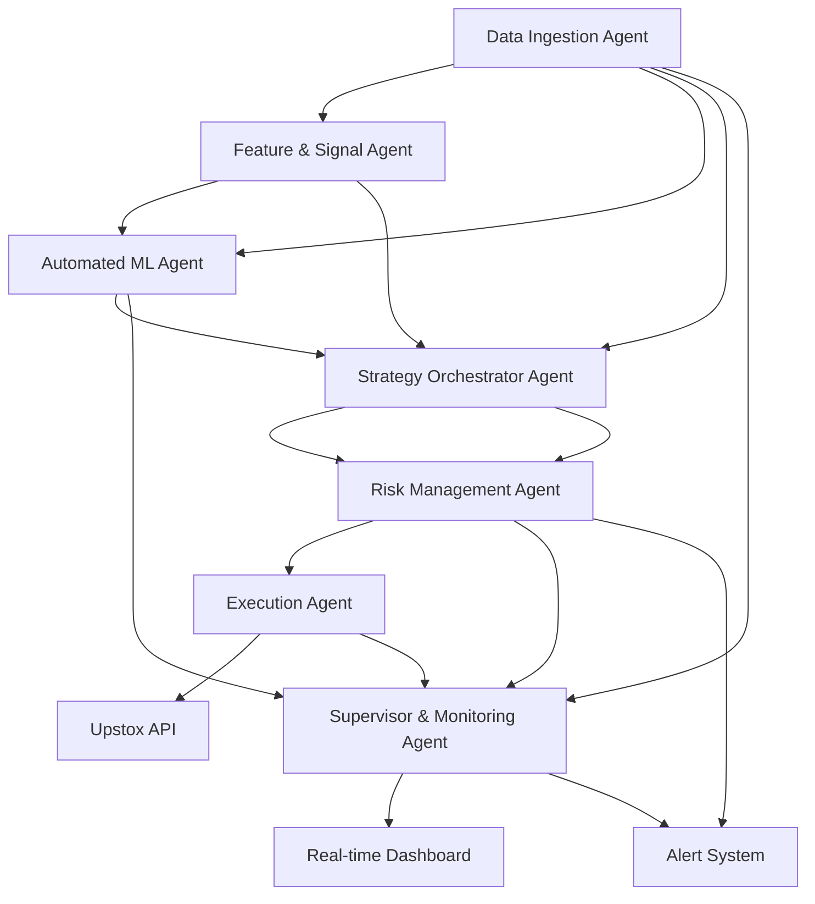

# 🤖 AI Trading System

A comprehensive, multi-agent AI trading system that integrates with the Upstox API for automated trading with advanced risk management, AI-powered analysis, and real-time monitoring.

 
 


## 🌟 Features

### 🤖 AI-Powered Analysis
- **Gemini AI Integration**: Advanced market sentiment analysis using Google's Gemini API
- **Azure OpenAI Integration**: Large language model-based market analysis
- **Technical Analysis**: RSI, MACD, Moving Averages, Bollinger Bands, ATR
- **Machine Learning**: LightGBM, XGBoost, and LSTM models for price prediction

### 🛡️ Risk Management
- **Ultimate Veto Power**: Risk management agent has final say on all trades
- **Position Sizing**: Dynamic position sizing based on portfolio risk
- **Stop Loss/Take Profit**: Automated stop-loss and take-profit mechanisms
- **Daily Loss Cap**: System-wide daily loss limits with circuit breakers
- **Diversification Rules**: Automatic portfolio diversification enforcement

### 📊 Real-Time Dashboard
- **Portfolio Overview**: Live portfolio value, returns, and performance metrics
- **Position Monitoring**: Real-time P&L tracking for all positions
- **Trading Signals**: Visual display of signals from all sources
- **Risk Metrics**: Live risk monitoring and alerts
- **Order Execution**: Direct order placement through the dashboard

### 🏗️ Multi-Agent Architecture
- **Data Agent**: Multi-source data ingestion with cross-validation
- **Technical Analysis Agent**: Classical technical indicator analysis
- **ML Agent**: Machine learning model training and deployment
- **Strategy Orchestrator**: Signal combination and decision making
- **Risk Manager**: Ultimate risk oversight and control
- **Execution Engine**: Order placement and management
- **Monitoring Agent**: System health and performance tracking
- **Supervisor Agent**: Conflict resolution and system orchestration

## 🚀 Quick Start

### Prerequisites
- Python 3.8 or higher
- Upstox API account
- Optional: Gemini API key or Azure OpenAI credentials

### 1. Clone the Repository
```bash
git clone <repository-url>
cd AI-Trading-System
```

### 2. Install Dependencies
```bash
pip install -r requirements.txt
```

### 3. Configure Environment
Create a `.env` file with your API credentials:

```env
# Required: Upstox API credentials
UPSTOX_API_KEY=your_upstox_api_key
UPSTOX_API_SECRET=your_upstox_api_secret

# Optional: AI API keys (at least one recommended)
GEMINI_API_KEY=your_gemini_api_key
AZURE_OPENAI_API_KEY=your_azure_openai_api_key
AZURE_OPENAI_ENDPOINT=your_azure_openai_endpoint

# Risk management parameters
MAX_RISK_PER_TRADE=0.005  # 0.5% of portfolio
DAILY_LOSS_CAP=0.03      # 3% daily loss cap

# Trading parameters
MAX_TRADES_PER_DAY=200
MIN_PROFIT_TARGET=0.002   # 0.2% minimum profit target

# ML model parameters
MODEL_UPDATE_INTERVAL=86400  # Daily model update

# Monitoring parameters
HEALTH_CHECK_INTERVAL=60     # Health check every 60 seconds
```

### 4. Start the System

#### Option A: Using the Startup Script (Recommended)
```bash
python start.py
```

#### Option B: Using Windows Batch File
```batch
start.bat
```

#### Option C: Using Docker
```bash
docker-compose up --build
```

### 5. Access the Dashboard
Open your browser and navigate to:
```
http://localhost:8000
```

## 📖 Detailed Setup Guide

### API Setup

#### Upstox API Setup
1. Create an account at [Upstox](https://upstox.com/)
2. Apply for API access
3. Generate API credentials
4. Add credentials to `.env` file

#### Gemini AI Setup (Optional)
1. Visit [Google AI Studio](https://aistudio.google.com/)
2. Create an API key
3. Add `GEMINI_API_KEY` to `.env` file

#### Azure OpenAI Setup (Optional)
1. Create an Azure account
2. Set up Azure OpenAI service
3. Get API key and endpoint
4. Add credentials to `.env` file

### Environment Configuration

The system supports extensive configuration through environment variables:

```env
# Data Sources
MARKET_DATA_SOURCES=upstox,finnhub,alpha_vantage
TICK_INTERVAL=1

# Technical Indicators
TECHNICAL_INDICATORS=rsi,macd,bollinger,ma,atr

# ML Models
ML_MODELS=lightgbm,xgboost,lstm
MODEL_UPDATE_INTERVAL=86400

# Strategy Parameters
STRATEGY_CONFIDENCE_THRESHOLD=0.7
REQUIRE_CONSENSUS=True

# Risk Management
STOP_LOSS_LEVELS=fixed,adaptive,trailing
SLIPPAGE_TOLERANCE=0.001

# Execution
DEFAULT_ORDER_TYPE=limit
DASHBOARD_PORT=8000

# Alerts
ALERT_CHANNELS=telegram,slack,email
```

## 🧪 Testing

### Run All Tests
```bash
pytest
```

### Run Specific Test Categories
```bash
# Unit tests only
pytest tests/ -m "not integration"

# Integration tests only
pytest tests/ -m integration

# AI integration tests (requires API keys)
pytest tests/ -m ai

# Performance tests
pytest tests/ -m slow
```

### Test Coverage
```bash
pytest --cov=agents --cov-report=html
```

## 🏗️ Architecture Overview



### Agent Responsibilities

| Agent | Responsibility |
|-------|----------------|
| **Data Agent** | Multi-source market data ingestion and validation |
| **Technical Agent** | Classical technical analysis and signal generation |
| **ML Agent** | Machine learning model training and predictions |
| **Strategy Orchestrator** | Signal combination and decision making |
| **Risk Manager** | Risk oversight with ultimate veto power |
| **Execution Engine** | Order placement and management via Upstox API |
| **Monitoring Agent** | System health monitoring and alerting |
| **Supervisor Agent** | High-level system coordination and conflict resolution |

## 🎯 Trading Strategy

### Signal Generation
1. **Technical Analysis**: RSI, MACD, Moving Averages, Bollinger Bands
2. **AI Analysis**: Gemini/Azure OpenAI market sentiment analysis
3. **ML Predictions**: Ensemble of LightGBM, XGBoost, and LSTM models
4. **Statistical Signals**: Mean reversion, momentum, volatility breakouts

### Decision Making Process
1. **Signal Collection**: Gather signals from all sources
2. **Consensus Building**: Require agreement among multiple sources
3. **Risk Validation**: Risk manager validates all decisions
4. **Order Execution**: Execute approved orders via Upstox API
5. **Monitoring**: Continuous performance and risk monitoring

### Risk Management Rules
- Maximum 0.5% risk per trade
- Daily loss cap of 3%
- Position size limits based on volatility
- Automatic stop-loss orders
- Circuit breakers for extreme market conditions

## 📊 Dashboard Features

### Portfolio Overview
- Real-time portfolio value and returns
- Daily P&L tracking
- Sharpe ratio and risk metrics
- Drawdown monitoring

### Trading Signals
- Live signals from all AI and technical sources
- Confidence scores for each signal
- Historical signal performance

### Risk Monitoring
- Real-time risk metrics
- Position exposure tracking
- Daily loss monitoring
- Volatility alerts

### Order Management
- Direct order placement
- Order status tracking
- Execution quality monitoring
- Trade history and analysis

## 🔧 Advanced Configuration

### Custom Indicators
Add custom technical indicators by extending the `TechnicalIndicator` class:

```python
class CustomIndicator(TechnicalIndicator):
    def calculate(self, data: pd.DataFrame) -> pd.DataFrame:
        # Your indicator calculation
        pass
    
    def generate_signal(self, data: pd.DataFrame) -> Dict:
        # Your signal generation logic
        pass
```

### Custom AI Models
Integrate additional AI services by implementing the AI integration interface:

```python
class CustomAIIntegration:
    def analyze_market(self, market_data: Dict) -> Dict:
        # Your AI analysis logic
        pass
    
    def generate_trading_signal(self, market_data: Dict) -> Dict:
        # Your signal generation logic
        pass
```

### Custom Risk Rules
Add custom risk management rules:

```python
class CustomRiskRule(RiskRule):
    def evaluate(self, order_details: Dict, portfolio_state: Dict) -> Dict:
        # Your risk evaluation logic
        pass
```

## 🚨 Important Warnings

⚠️ **FINANCIAL RISK WARNING** ⚠️

- This system trades real money and can result in financial losses
- Start with paper trading or very small amounts
- Thoroughly test all strategies before deploying capital
- Monitor the system continuously during operation
- The developers are not responsible for any financial losses

### Recommended Best Practices
1. **Start Small**: Begin with minimal position sizes
2. **Monitor Actively**: Watch the dashboard during market hours
3. **Test Thoroughly**: Run extensive backtests before live trading
4. **Gradual Scaling**: Increase position sizes gradually as confidence grows
5. **Regular Reviews**: Review and adjust strategies regularly

## 📈 Performance Monitoring

### Key Metrics
- **Win Rate**: Percentage of profitable trades
- **Profit Factor**: Ratio of gross profit to gross loss
- **Sharpe Ratio**: Risk-adjusted returns
- **Maximum Drawdown**: Largest peak-to-trough decline
- **Daily P&L**: Daily profit and loss tracking

### Alerts and Notifications
- Daily loss cap reached
- Individual trade stop-loss triggered
- System connectivity issues
- Model performance degradation
- High volatility conditions

## 🛠️ Troubleshooting

### Common Issues

#### "Module not found" errors
```bash
pip install -r requirements.txt
```

#### API connection failures
- Check your internet connection
- Verify API credentials in `.env` file
- Check API rate limits

#### Dashboard not loading
- Ensure port 8000 is not in use
- Check firewall settings
- Try a different port in configuration

#### Tests failing
- Ensure all dependencies are installed
- Check API credentials for integration tests
- Run tests individually to isolate issues

### Logs and Debugging
- System logs are stored in `logs/` directory
- Dashboard errors are shown in the Streamlit interface
- Use `--verbose` flag for detailed startup information

## 🤝 Contributing

We welcome contributions! Please see our [Contributing Guidelines](CONTRIBUTING.md) for details.

### Development Setup
1. Fork the repository
2. Create a feature branch
3. Make your changes
4. Add tests for new functionality
5. Run the test suite
6. Submit a pull request

## 📄 License

This project is licensed under the MIT License - see the [LICENSE](LICENSE) file for details.

## 📞 Support

- **Documentation**: Check this README and inline code comments
- **Issues**: Report bugs and request features via GitHub Issues
- **Discussions**: Join our GitHub Discussions for questions and ideas

## 🙏 Acknowledgments

- **Upstox** for providing the trading API
- **Google** for the Gemini AI API
- **Microsoft** for Azure OpenAI services
- **Open Source Community** for the amazing libraries used in this project

---

**⚡ Happy Trading! ⚡**

*Remember: Past performance does not guarantee future results. Trade responsibly.*